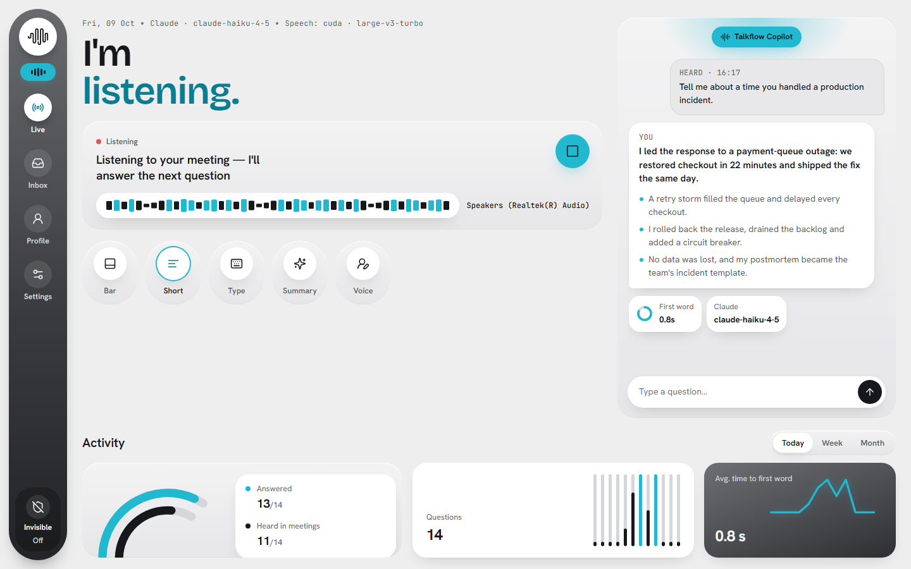
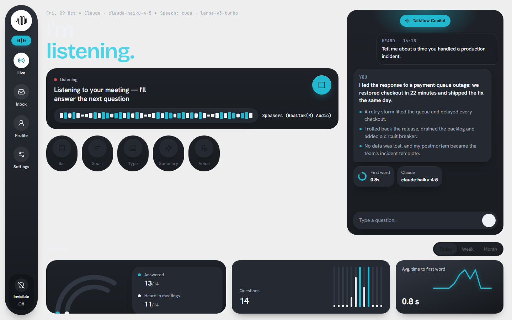
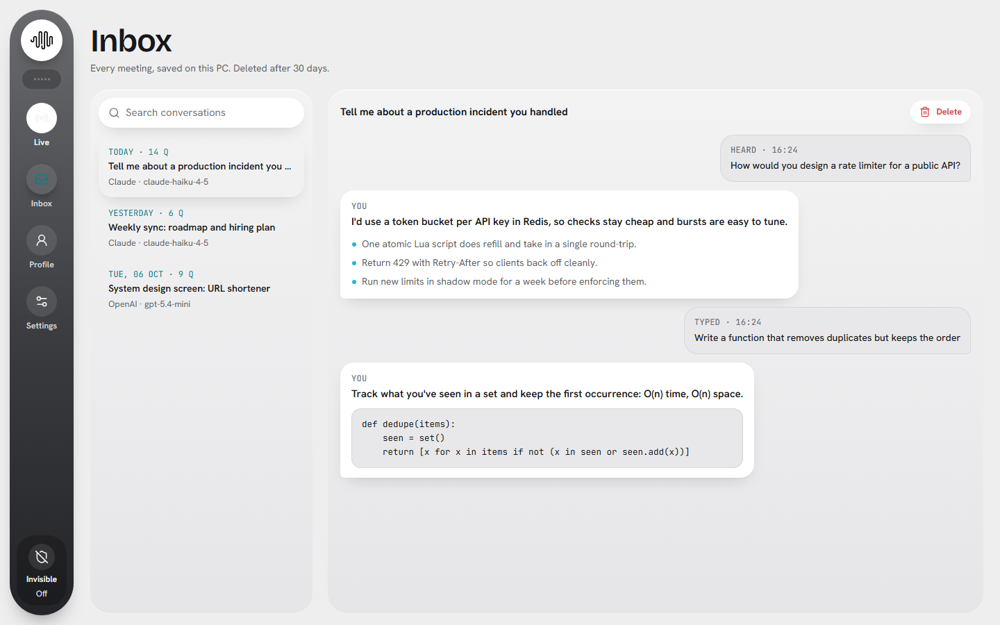
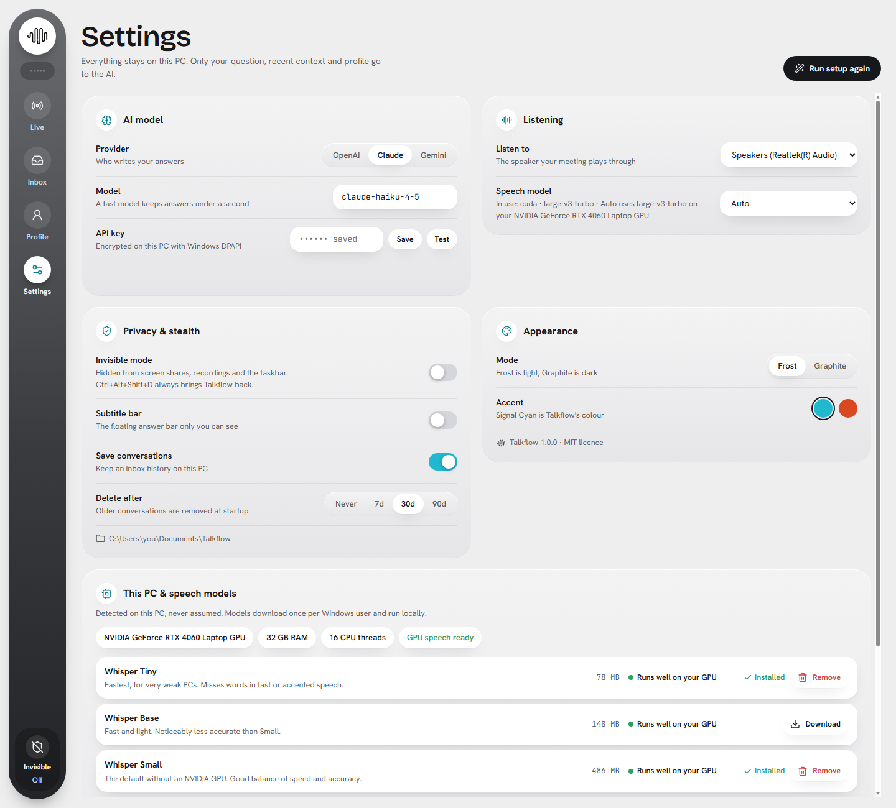
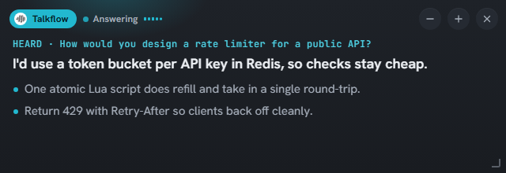

<p align="center"></p>

<h1 align="center">Talkflow</h1>

<p align="center"><b>A real-time AI copilot for meetings and interviews: suggested answers in your own words, ready before you speak.</b></p>

<p align="center">
  <a href="https://github.com/Zehnix/talkflow-releases/releases/latest"><b>Download for Windows</b></a> ·
  <a href="CHANGELOG.md">What's new</a> ·
  <a href="PRIVACY.md">Privacy</a> ·
  <a href="https://github.com/Zehnix/talkflow-releases/issues">Report a problem</a>
</p>



Talkflow listens to a conversation through your speakers, or takes a typed question. It notices when a question is asked and writes a clear answer in your own voice, in the main window and on a small always-on-top bar. Speech recognition runs on your PC and audio never leaves it. To write an answer, Talkflow sends the question, the last few lines of the meeting as text, your recent Q&A and your profile to the AI provider you choose (OpenAI, Claude or Gemini), with your own API key.

This repository holds Talkflow's releases, documentation and issue tracker. The source code is not public.

---

## Screenshots

| | |
|---|---|
|  |  |
| **Graphite (dark) mode** | **Inbox**: every meeting, searchable, saved on your PC |
|  |  |
| **Settings**: AI provider, privacy, and your PC's speech models | **The floating bar**: the answer over your meeting, with a live audio meter |

## Features

**Listening and answering**
- **Hears the meeting.** Captures what plays on your speakers. No virtual cable, and you still hear everything.
- **Answers as you.** First person, grounded in a profile you write, streamed word by word. Pick a tone (confident, concise, warm, technical, STAR stories) and short or detailed answers.
- **Glanceable.** A bold one-line answer plus a few scannable points, readable in seconds.
- **Type a question** any time, with or without listening.
- **Live audio meters** in the side rail and on the bar, so you can see that audio is arriving.
- **Meeting summaries** with decisions, action items and open questions.

**Speech recognition on your PC**
- **Whisper models**, from tiny to large-v3, running locally. Only text ever goes to the AI provider.
- **Detects your PC** (GPU, RAM, CPU threads) and picks the best model that runs live. Large-v3 Turbo runs on NVIDIA GPUs and Small on the CPU.
- **Speech models card:** each model's size, how well it fits your PC, and whether it's installed or in use, with Download (live progress) and Remove.
- **Optional GPU add-on** in the installer: NVIDIA CUDA libraries, about 1 GB.

**Privacy and control**
- **No account, no analytics.** API keys are encrypted with Windows DPAPI. Conversations stay in `Documents\Talkflow`, with automatic deletion after 7, 30 or 90 days if you want it.
- **Opt-in invisible mode.** Off by default. When you turn it on, Talkflow's windows are left out of screen shares and recordings by apps that respect Windows' capture exclusion, and it leaves the taskbar. **Ctrl+Alt+Shift+D** always brings it back.
- **Optional launch password.**

**Look and feel**
- Frost (light) and Graphite (dark) modes, with Signal Cyan or Ember accents.
- An Activity dashboard: questions answered, time to first word, and questions over time.
- A guided first-run setup: provider, key test, profile, and a responsible-use acknowledgement.

## Install

**Needs:** Windows 10 version 2004 or later, or Windows 11 (64-bit), and an API key from OpenAI, Anthropic (Claude) or Google (Gemini). An NVIDIA graphics card is optional; it makes the larger speech models fast.

1. Download **`Talkflow-Setup-x.y.z.exe`** from the [latest release](https://github.com/Zehnix/talkflow-releases/releases/latest).
2. Run it. No admin rights are needed: it installs for your user, and offers "all users" if you prefer.
3. Optional during setup: tick **GPU speech recognition** if you have an NVIDIA card (downloads about 1 GB).
4. On first start, pick your AI provider, paste and test your key, and write a short profile. Then type a question, or press **Start listening**.

The installer isn't code-signed yet, so Windows may show *"Windows protected your PC"*. Click **More info → Run anyway**. On PCs with **Smart App Control** turned on, unsigned installers can be blocked entirely.

**Check your download.** Each release lists the setup's SHA-256 in `SHA256SUMS.txt`. Compare it with the output of this command:

```powershell
Get-FileHash .\Talkflow-Setup-*.exe -Algorithm SHA256
```

**Silent install** (for scripts): `Talkflow-Setup-x.y.z.exe /VERYSILENT /CURRENTUSER`. Add `/TASKS="desktopicon,gpu"` to choose the optional tasks.

**Uninstall** from *Settings → Apps*. Your conversations (`Documents\Talkflow`) and settings (`%APPDATA%\Talkflow`) are kept; delete those folders to remove everything.

## Privacy

No account, no analytics, and no telemetry. Talkflow uses the network only when it writes an answer or summary or tests your key (your chosen AI provider, your key), when it downloads a speech model (Hugging Face), and for the optional GPU add-on at setup (PyPI). The full details are in the [privacy policy](PRIVACY.md).

## Responsible use

Talkflow transcribes what other people say and suggests what you could answer. Use it openly:

- Tell the people you meet that you use live transcription and an AI assistant.
- Follow the rules of every meeting, interview, exam or test you take part in. Many interviews and tests don't allow assistance.
- Recording or transcribing others may need their consent where you live.

Setup asks you to confirm this before first use. Invisible mode is off by default and explains itself the first time you turn it on.

## Support

Found a bug or have an idea? [Open an issue](https://github.com/Zehnix/talkflow-releases/issues/new/choose). For a bug, attach the log from `%LOCALAPPDATA%\Talkflow\talkflow.log`. It holds startup and error messages rather than your conversations; read it before you post it. Security problems: see [SECURITY.md](SECURITY.md).

## Licence

Talkflow is released under the [MIT licence](LICENSE) © 2026 Zehnix. It bundles third-party components under their own licences, listed in [THIRD-PARTY-NOTICES.md](THIRD-PARTY-NOTICES.md) with the full texts in [licenses/](licenses).
